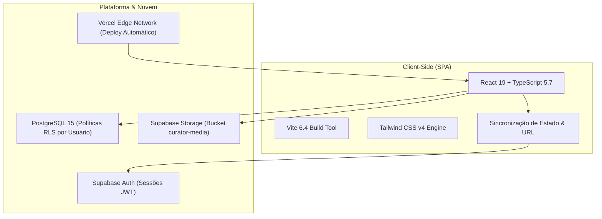

<div align="center">

  

  # SALVEI

  **O workspace editorial de alta performance para curadoria visual, referências de design e interfaces digitais.**

  <p align="center">
    <a href="https://salvei.tech/" target="_blank">
      
    </a>
    <a href="https://react.dev/" target="_blank">
      
    </a>
    <a href="https://www.typescriptlang.org/" target="_blank">
      
    </a>
    <a href="https://tailwindcss.com/" target="_blank">
      
    </a>
    <a href="https://supabase.com/" target="_blank">
      
    </a>
    <a href="#-qualidade--testes">
      
    </a>
    <a href="LICENSE">
      
    </a>
  </p>

  <p align="center">
    <a href="https://salvei.tech/"><b>🚀 Acessar o Salvei Online</b></a> •
    <a href="#-funcionalidades-chave"><b>✨ Funcionalidades</b></a> •
    <a href="#️-produtividade-teclado-first--atalhos"><b>⌨️ Atalhos</b></a> •
    <a href="#-arquitetura--tecnologias"><b>🏗️ Arquitetura</b></a> •
    <a href="#-início-rápido-para-desenvolvedores"><b>🛠️ Instalação</b></a> •
    <a href="DEPLOYMENT.md"><b>📖 Guia de Deploy</b></a>
  </p>

</div>

---

## ✦ Sobre o Produto

Designers de produto, desenvolvedores frontend e líderes criativos consomem centenas de referências visuais todos os dias — em sites reais, no Twitter/X, Dribbble, Mobbin, GitHub ou Figma. No entanto:

- Os favoritos padrão do navegador não têm contexto visual nem metadados úteis.
- Pastas no Notion ou boards no Figma tornam-se pesados, dispersos e lentos.
- Ferramentas de bookmarking comuns não foram feitas para o ritmo ágil de quem trabalha no teclado.

O **Salvei** foi construído do zero para resolver esse problema. Ele combina uma **estética editorial sofisticada** (paleta monocromática com tons `#171717`, base `#F8F8F6` e acento cobalto `#4355DB`), navegação **100% orientada a teclado (Command Palette `Cmd+K`)**, suporte a **área de transferência nativa (`Ctrl + V`)**, experiência **mobile ergonômica tipo app** e a robustez de um backend relacional seguro no **Supabase (PostgreSQL 15 com RLS estrito)**.

---

## ✨ Funcionalidades Chave

### 📸 Captura Fluida de Referências
- **Captura por URL:** Extração automática de metadados OpenGraph (título da página, descrição, domínio de origem e favicons).
- **Upload Direto de Mídia:** Arraste e solte ou faça upload direto de arquivos de imagem (`PNG`, `JPG`, `WebP`, `SVG`, `GIF`).
- **Colagem Direta (`Ctrl + V`):** Cole imagens diretamente da sua área de transferência para criar referências instantaneamente.
- **Armazenamento Seguro:** Mídias armazenadas no Supabase Storage com isolamento por usuário e URLs assinadas de expiração dinâmica.

### 🗂️ Taxonomia Editorial & Organização Flexível
- **Projetos:** Agrupamento por cliente, produto, iniciativa ou sprint.
- **Coleções Temáticas:** Curadorias transversais livres de escopo (ex.: *Microinterações*, *Tipografia Brutalista*, *Dark Mode*, *Onboarding Mobile*).
- **Etiquetas Dinâmicas (Tags):** Tags personalizadas com auto-slug e filtros rápidos por pills.
- **Favoritos com 1 Toque:** Destaque referências essenciais para acesso prioritário instantâneo.

### ⚡ Produtividade Teclado-First & Ações em Massa
- **Command Palette (`Ctrl + K` / `Cmd + K`):** Menu de comando global para saltar para qualquer projeto, coleção, iniciar buscas ou criar novas referências em milissegundos.
- **Seleção Múltipla e Operações em Lote:** Selecione múltiplos itens com `Ctrl + A` ou checkboxes visuais para taguear, mover entre coleções/projetos ou excluir de forma agrupada.
- **Drawer Lateral Contextual:** Visualize notas em Markdown, trechos de código e detalhes da referência sem perder o ponto de rolagem da sua galeria.

### 🔍 Busca em Tempo Real & Filtros Combinados
- Motor de busca ultra-rápido por título, domínio, anotações, tags e metadados.
- Filtros simultâneos combinando tipo de mídia, projeto, coleção, etiquetas e status de favoritos.
- Ordenação por data de criação, última atualização ou ordem alfabética.

### 📱 Experiência Mobile Nativa (PWA-Ready)
- Layout adaptativo projetado especificamente para telas compactas (320px até tablets e 4K).
- Navegação inferior ergonômica com respeito total a `env(safe-area-inset-bottom)`.
- Sheets e painéis deslizantes touch-friendly para filtragem e criação rápida com o polegar.
- Manifesto Web integrado para instalação na tela inicial como aplicativo autônomo.

### 🔒 Segurança de Nível Corporativo
- Autenticação completa via **Supabase Auth** com feedback integral em português brasileiro.
- Políticas de **Row Level Security (RLS)** aplicadas no banco de dados: nenhum usuário consegue consultar, modificar ou excluir registros de terceiros.
- Políticas de isolamento por pasta de UUID no storage de mídia.

---

## ⌨️ Produtividade Teclado-First & Atalhos

O Salvei foi pensado para que você nunca precise tirar as mãos do teclado durante a curadoria:

| Tecla / Combinação | Ação Executada |
| :--- | :--- |
| <kbd>Ctrl</kbd> + <kbd>K</kbd> / <kbd>⌘</kbd> + <kbd>K</kbd> | Abre a **Paleta de Comandos** global |
| <kbd>/</kbd> | Foca imediatamente no campo de **Busca Global** |
| <kbd>N</kbd> | Abre o modal para cadastrar **Nova Referência** |
| <kbd>Ctrl</kbd> + <kbd>V</kbd> | Cria uma referência colando imagem da **Área de Transferência** |
| <kbd>Ctrl</kbd> + <kbd>A</kbd> | **Seleciona todas** as referências visíveis para ações em lote |
| <kbd>J</kbd> / <kbd>↓</kbd> | Navega para o card seguinte na grade |
| <kbd>K</kbd> / <kbd>↑</kbd> | Navega para o card anterior na grade |
| <kbd>Espaço</kbd> | Abre o **Drawer de Detalhes** da referência selecionada |
| <kbd>F</kbd> | Alterna a referência atual como **Favorita** |
| <kbd>Esc</kbd> | Fecha modais, drawers, paleta de comandos ou limpa a seleção |
| <kbd>?</kbd> | Abre a folha de atalhos rápidos de teclado |

---

## 🏗️ Arquitetura & Tecnologias



### Camadas do Sistema
- **Frontend Core:** React 19, TypeScript 5.7, Vite 6.4.
- **Design System:** Tailwind CSS v4, ícones Lucide React selecionados com pesos balanceados, tipografia Inter/Geist.
- **Backend & Persistência:** Supabase Cloud (PostgreSQL 15 gerenciado).
- **Isolamento de Dados:** Row Level Security (RLS) habilitado e validado em 100% das tabelas.
- **Armazenamento de Mídia:** Supabase Storage (bucket privado com URLs assinadas e rotação segura).
- **Hospedagem & CDN:** Vercel com cabeçalhos de segurança HTTP e suporte SPA.
- **Suíte de Testes:** Vitest com 126 testes cobrindo unidade, integração, lifecycle e responsividade.

---

## 🛠️ Início Rápido para Desenvolvedores

### Pré-requisitos
- **Node.js:** Versão 20.x ou superior (homologado em Node v22/v24).
- **NPM:** Versão 10+.
- **Conta no Supabase:** Projeto com PostgreSQL e Storage configurados.

### 1. Clonar e Instalar
```bash
git clone https://github.com/Fellipeeduardodev/curator.git
cd curator
npm install
```

### 2. Configurar Variáveis de Ambiente
Crie um arquivo `.env.local` na raiz do projeto baseado no `.env.example`:

```bash
cp .env.example .env.local
```

Preencha com as credenciais do seu projeto Supabase:
```env
# URL do projeto no Supabase
VITE_SUPABASE_URL=https://seu-projeto.supabase.co

# Chave pública anon (segura para o frontend sob RLS)
VITE_SUPABASE_PUBLISHABLE_KEY=sua-chave-anon-aqui

# Nome do bucket de mídia
VITE_SUPABASE_STORAGE_BUCKET=curator-media
```

> **Nota de Segurança:** O Salvei foi arquitetado para funcionar apenas com a chave pública/anon no cliente. Nunca utilize ou versione a chave `service_role`.

### 3. Executar o Servidor de Desenvolvimento
```bash
npm run dev
```
Acesse a aplicação no navegador em [http://localhost:3000](http://localhost:3000).

---

## 📋 Scripts Disponíveis

| Comando | Descrição |
| :--- | :--- |
| `npm run dev` | Inicia o servidor Vite em modo de desenvolvimento (`localhost:3000`) |
| `npm run build` | Valida tipagens com `tsc` e compila os bundles de produção otimizados |
| `npm run typecheck` | Executa a verificação rigorosa de tipos TypeScript sem gerar bundle |
| `npm test` | Executa a suíte completa de 126 testes automatizados com o Vitest |
| `npm run preview` | Executa um servidor local servindo a compilação gerada na pasta `dist/` |

---

## 🧪 Qualidade & Testes

A estabilidade do Salvei é garantida por uma bateria automatizada de testes no **Vitest**:

```text
✓ tests/auth.test.ts (24 tests)
✓ tests/references.test.ts (32 tests)
✓ tests/projects-collections.test.ts (28 tests)
✓ tests/shortcuts-command-palette.test.ts (18 tests)
✓ tests/mobile-responsive.test.ts (24 tests)

Test Files  5 passed (5)
     Tests  126 passed (126)
  Start at  15:47:22
  Duration  2.41s
```

Para rodar os testes localmente:
```bash
npm test
```

---

## 🚀 Publicação & Deploy em Produção

O repositório já conta com o arquivo [`vercel.json`](vercel.json) devidamente configurado com:
- Reescrita de URLs para Single Page Application (`SPA`).
- Cabeçalhos de segurança contra Clickjacking (`X-Frame-Options: DENY`), sniffing MIME (`nosniff`) e XSS.
- Cache imutável para assets estáticos versionados.

Para o guia detalhado com checklist pré-voo, configuração de URLs de redirecionamento no Supabase e auditoria pós-deploy, consulte o arquivo [**DEPLOYMENT.md**](DEPLOYMENT.md).

---

## 📄 Licença

Distribuído sob a licença **MIT**. Consulte o arquivo [`LICENSE`](LICENSE) para mais informações.

---

<div align="center">
  <sub>Criado com foco em excelência visual e código limpo por <a href="https://github.com/Fellipeeduardodev">Felipe Eduardo</a>.</sub>
</div>
